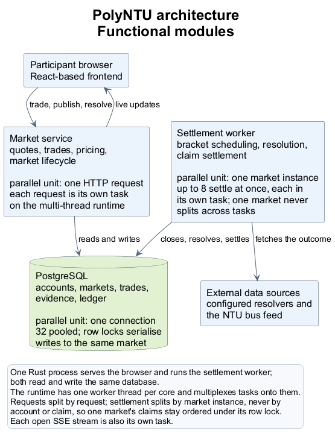
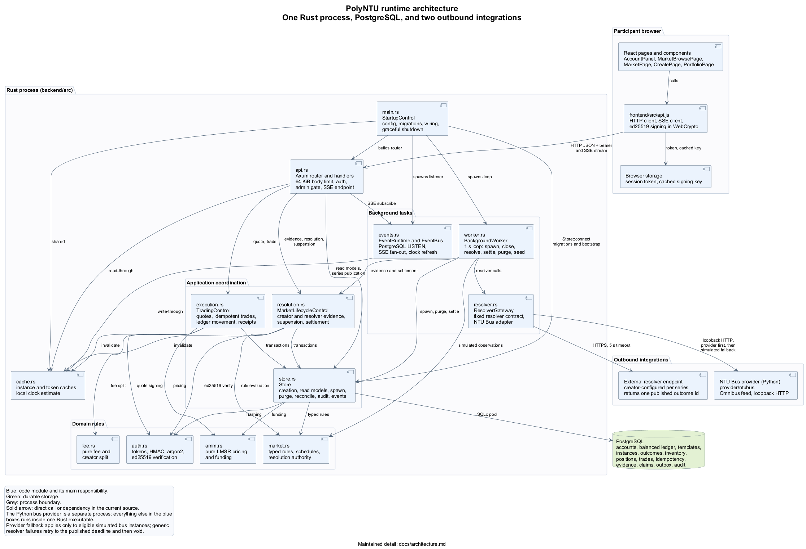

# PolyNTU architecture

Status: **current**  
Application version: **0.2**  
Startup, architecture style, and provider boundary reviewed: **23 October 2026**.

Other detailed runtime sections retain the **20 September 2026** review baseline.

## Architectural style and rationale

PolyNTU uses a **layered client-server architecture with a monolithic Rust backend**. React supplies the browser presentation, Axum and application functions coordinate requests and domain behaviour, and PostgreSQL provides durable storage. The Rust executable serves the built frontend, HTTP API, and SSE streams and runs the lifecycle worker and event tasks in the same process. External resolvers, including the optional Python NTU bus provider, are separate integrations.

| Logical responsibility | Current implementation | Design-model mapping |
|---|---|---|
| Presentation and interaction | React pages/components and `frontend/src/api.js` | User boundary classes. |
| HTTP boundary | Axum routes/handlers in `backend/src/api.rs` | `ApiRouter`, `AdminApi`, and the HTTP paths summarized by browser-to-control dependencies. |
| Application coordination | Functions in `api.rs`, `store.rs`, `execution.rs`, `resolution.rs`, and `worker.rs` | Seven logical use-case controls. |
| Domain rules and calculations | `market.rs`, `amm.rs`, `fee.rs`; authentication/signature helpers in `auth.rs` | Domain values and helpers used by controls. |
| Persistence | SQLx/PostgreSQL access through `Store` and its methods | `Store` infrastructure and persisted entities. |
| Startup and background work | `main.rs`, `worker.rs`, and `events.rs` | `StartupControl`, `BackgroundWorker`, `EventRuntime`, and `EventBus`. |
| Outbound integration | `resolver.rs` and optional `provider/ntubus` service | `ResolverGateway`; the provider remains outside the core application process. |

These are logical layers: `Store` combines application behaviour and data access, and some worker/API code executes SQL directly. The design model records responsibility ownership without claiming a strict service/repository split or separate controller instances.

The monolithic backend keeps the academic application's deployment and shared transaction coordination simple. Rust/Axum supports concurrent HTTP and background work in one runtime; React provides reusable interactive boundaries; PostgreSQL supplies the transactions, constraints, and locking used by trading and settlement. Pure pricing and fee calculations keep those rules independent of HTTP, storage, and external-provider availability. The resolver contract gives provider-specific acquisition a separate integration boundary. These choices justify the existing design; they do not introduce a new stack or replace the separate Lab 3.3 AI exercise.

For the class model and use-case mapping, see [class diagram](developer/class-diagram.md). The scoped Lab 3 handoff is [steps 1-4](../lab3/steps-1-4-handoff.md).

## System context

PolyNTU is one deployable application backed by PostgreSQL. The Rust executable serves the versioned JSON API, Server-Sent Events, and the built React files. It also starts a periodic background worker from the same codebase.



The module-level view above is the summary. The detailed view below names each source module and the calls between them.



Market categories provide typed rules and evidence evaluation only. They do not receive network access, calculate prices, authenticate users, or move balances.

## Runtime startup

`backend/src/main.rs` performs startup in this order:

1. Configure tracing from `RUST_LOG` or the default filter.
2. Read the required database URL, quote secret, and administrator token; read demo mode and parse the bind address.
3. Reject a non-loopback bind when demo mode is enabled.
4. Call `Store::connect` to connect to PostgreSQL, apply embedded SQLx migrations, initialize fixed accounts/settings, and initialize the cached clock offset.
5. Apply `POLYNTU_NTUBUS_PROVIDER` when supplied; create `EventBus`; construct `AppState`, which rejects short or identical secrets; and install the shared event bus.
6. Seed demo markets when demo mode is enabled.
7. Parse CORS origins, configure the frontend directory, build the API/router layers and static-file fallback, and bind the TCP listener.
8. Spawn `worker::run`, `events::run_listener`, and `events::run_clock_refresher`. The clock refresher returns immediately outside demo mode.
9. Serve until Ctrl+C requests graceful HTTP shutdown; after a normal server return, abort all three task handles.

`StartupControl` models this existing free `main` function; its diagram dependencies identify the components initialized, not seven newly instantiated controller objects. Database bootstrap is delegated to `Store::connect`/`initialize`, and secret validation to `AppState::new`. Startup errors propagate through `Result`; this description does not claim that all configuration is validated before database initialization or that every error path performs the normal shutdown sequence.

The executable contains the backend only. The Docker build compiles React separately and copies `frontend/dist` into the final image.

## Active source modules

| File | Responsibility and boundaries |
|---|---|
| `backend/src/lib.rs` | Exposes active modules and forbids `unsafe` code in the application crate. |
| `backend/src/main.rs` | Process configuration, database connection, optional provider configuration, shared event/state setup, router construction, three background task launches, static delivery, and normal graceful HTTP shutdown. |
| `backend/src/error.rs` | Shared error categories and conversion to the API error envelope. Internal/database details are logged but hidden from clients. |
| `backend/src/auth.rs` | Random bearer tokens, SHA-256 hashing, HMAC-SHA256 signed values, token verification, minimum secret validation, constant-time administrator-token comparison, and ed25519 resolution-signature verification (ADR 0007). |
| `backend/src/amm.rs` | Pure LMSR arithmetic, input bounds, funding calculation, prices, and rounded trade amounts. It has no database, clock, network, account, or RNG access. |
| `backend/src/fee.rs` | Pure trading-fee, all-in amount, and creator-share calculations used by execution and settlement. |
| `backend/src/market.rs` | Outcomes, typed rules and observations, validation, evaluation, instance and series types, schedules, the resolution authority spec, and demo specifications. |
| `backend/src/execution.rs` | Quote structures, signing claims, amount parsing, idempotency, transaction locking, execution checks, ledger movement, positions, trades, receipts, and trade outbox events. |
| `backend/src/store.rs` | Pool setup, migrations, bootstrap, database time, account provisioning, instance and series creation/read models, rolling bracket spawn, terminal-bracket retention purge, portfolio and trade history queries, bucketed instance history and the series day view, transfers, audit/events, and reconciliation. |
| `backend/src/cache.rs` | Read-through instance and token caches with a local clock estimate; every mutation invalidates or writes through before returning. |
| `backend/src/events.rs` | PostgreSQL notification listener, per-instance SSE broadcast channels, and demo clock refresh. |
| `backend/src/resolution.rs` | Evidence validation/deduplication, creator-signed and resolver evidence recording, suspensions, due-market closing, finalization, bounded settlement, reserve release, and demo clock changes. |
| `backend/src/resolver.rs` | External resolver contract (ADR 0007), bounded HTTP(S) calls, response validation against published outcomes, and the built-in bus adapter's optional live-provider path and simulated fallback. |
| `backend/src/worker.rs` | One-second scheduling loop, rolling series bracket spawn, fair actionable-instance selection, private deterministic simulator evidence, external resolver calls, concurrent bounded settlement, terminal-bracket retention purge, and demo seeding (including the rolling bus series). |

See [backend code reference](developer/backend.md) for important types and functions in each file.

## Data and responsibility boundaries

### Browser

The browser owns navigation, presentation, local input checks, polling, SSE-triggered refreshes, and recovery of an uncertain request. It does not decide price validity, market state, ownership, balance sufficiency, settlement, or evidence correctness.

### API and services

Axum authenticates requests and applies the 64 KiB body limit. Service methods validate domain inputs and own transaction boundaries. Every state-changing decision is rechecked against database state.

### PostgreSQL

PostgreSQL is the durable authority for time-adjusted cutoffs, accounts, ledger balances, inventory, positions, idempotency responses, evidence, results, claims, events, and audit records. Constraints and triggers protect invariants even when a future code path is added incorrectly.

### External evidence adapters

Other integrations implement the fixed resolver contract and return a published outcome ID ([ADR 0007](decisions/0007-resolution-authority.md)). The repository also includes a [Python NTU bus provider](../provider/ntubus/README.md) behind the built-in `POST /api/v2/resolvers/ntu-bus` adapter. Generic resolver failures retry until the published deadline and then void.

## Authoritative time

`db_now` reads PostgreSQL `clock_timestamp()` and adds the persisted demo offset from the singleton settings row. Quote expiry, market close, evidence acceptance, finalization, and audit timestamps use that value. Browser time only drives display formatting and a locally adjusted countdown.

Demo mode persists its offset and limits the cumulative offset to ten years. A single advance request accepts 1–10,080 minutes. Production and demo processes must use separate databases; startup rejects a stored mode mismatch.

## Transaction boundaries

### Quote

A quote performs reads only, served from a read-through instance cache and a local estimate of the database clock, so a cache hit costs no database round trips:

1. load the instance from the cache, fetching it from PostgreSQL on a miss;
2. read the cached clock estimate;
3. confirm it is open, before its close, and not suspended;
4. map the outcome ID to its fixed index;
5. calculate the bounded LMSR amount and before/after prices; and
6. sign account, instance, outcome, side, quantity, amount, version, expiry, and engine version.

It does not reserve inventory or write an idempotency row. The cache is safe because quotes are previews: execution re-validates every claim inside its transaction, so a stale entry can only produce a quote that execution rejects. Mutations invalidate or write through the cache before returning, committed trades update inventory and version in place, and each process's notification listener applies the same updates for writes made by other processes. Entries expire after two seconds regardless. Token-to-account resolution is cached the same way; that mapping is immutable, and balances are always read fresh when they matter.

### Trade

One PostgreSQL transaction owns the entire trade. The actual ordering is:

1. insert the account-scoped idempotency claim if absent, replaying any committed response on conflict;
2. lock the instance row with `FOR UPDATE`, then read the authoritative clock in a separate statement, so a request that waited on the lock rechecks its close time against a fresh clock;
3. lock the participant and reserve account rows in sorted ID order using `FOR NO KEY UPDATE`, reading both balances and the current position in the same statement;
4. recheck state, cutoff, quote expiry, version, signed amount, user limit, balance, holdings, and reserve coverage;
5. insert a balanced transfer, whose trigger updates both account balances; and
6. apply the remaining writes — position upsert, inventory/version update, immutable trade, idempotency response, outbox event, and the commit-time notification — in one data-modifying common table expression, then commit before returning the receipt.

There is no separate explicit position-row lock. The instance lock serializes all trades that could modify positions or inventory for that instance. The participant account lock separately serializes spending across different markets. This distinction is important when changing the locking design.

Foreign-key checks can hold `KEY SHARE` locks on accounts during idempotency and position writes. `FOR NO KEY UPDATE` remains compatible with those locks while still serializing balance updates. PostgreSQL deadlock, serialization, and lock-timeout errors (`40P01`, `40001`, and `55P03`) receive up to three attempts with short backoff. Clients must keep the same idempotency key when retrying an uncertain request.

### Instance creation

Instance creation validates the complete immutable specification, derives category and outcomes from the rule, calculates required funding, creates the reserve account, transfers its subsidy from the treasury, inserts the instance, and writes an `opened` event in one transaction. The demo seeder's non-series creations also record an audit row; scheduler-spawned brackets publish through the outbox event only.

Series publication validates the schedule, requires the creator role under an account lock, inserts the immutable series row plus a template row under the series ID, and audits the creation. A one-time schedule immediately publishes its single bracket through instance creation; if funding fails, the series row is removed again.

### Evidence

Evidence ingestion locks the instance, validates the source/window/state/deadline, checks duplicate event content and source revisions, evaluates the typed observation, appends the record, points the instance to the highest revision, advances its version, audits the receipt, and appends an event in one transaction. The simulator path refuses any series-owned market, so it can only settle the demo's own series-less markets (ADR 0007). Creator-signed resolutions and validated resolver answers enter through their own recorders under the same instance lock; neither runs rule evaluation, because the authority itself names the outcome.

### Settlement

`settle_batch` locks one instance. Once eligible, it fixes the latest complete evaluated result or applies the deadline void policy. It then selects at most 100 unsettled participant accounts, locks them with the reserve and treasury, credits unique claims, and commits the batch. When no claims remain, it returns unused reserve to the treasury and marks the instance `resolved` or `voided`.

## Lifecycle and immutability

The persisted transitions are:

```text
open -> closed -> resolving -> resolved
                           \-> voided
```

Migration `0002_immutable_rules.sql` rejects changes to published template/category/title/rule/outcomes/source/data mode/times/liquidity/reserve fields. It requires each instance update to advance its version exactly once, forbids inventory changes after closing, and prevents updates to terminal instances or fixed results. Migration `0009_market_series.sql` extends the protected set with the fee flag, creator attribution, series membership, and bracket slot, and applies the same immutability to series definitions, whose only mutable field is the lifecycle state. Migration `0010_resolution_authority.sql` adds the resolution authority, public key, and resolver endpoint to the protected series definition (ADR 0007).

Ledger transfers, trades, evidence, settlement claims, and administrator audit records are append-only through database triggers; the single sanctioned delete path is the bracket retention purge described below. Idempotency rows are intentionally updated once with the durable response.

## Data retention

One rule covers the current retention behaviour: terminal brackets of recurring series are disposable after a day, everything else stays.

- Deleted: a recurring-series bracket in state `resolved` or `voided` whose evidence deadline passed more than 24 hours ago is purged with its whole subtree (outbox rows, positions, trades, settlement claims, evidence, and the instance) in batches of 20 per worker tick. One-time markets are never purged.
- Kept forever: the append-only accounting history. Every ledger transfer is shared between two accounts, so drained reserve accounts and their ledger trails survive every purge; admin audit and idempotency rows survive too, since neither references instances by foreign key.
- A reserve that still holds units blocks the purge, so a settlement anomaly surfaces instead of vanishing.
- The only delete path through the append-only triggers is this purge, which runs inside a transaction setting the session-local `polyntu.purge = 'on'` flag (migration `0011_bracket_retention.sql`); every other update or delete keeps raising.

## Worker scheduling and fairness

The worker ticks every second and skips accumulated timer ticks. Each cycle:

1. persists closure for up to 100 due open instances using `FOR UPDATE SKIP LOCKED`;
2. spawns due brackets for every active recurring series, keeping each rolling horizon filled inside its active window and ending finished series;
3. selects up to 100 actionable instances rather than simply the oldest closed rows;
4. generates evidence for due simulated instances using a hash of a private database secret and instance ID;
5. asks resolver-authority instances' configured endpoints from their finalize window (ADR 0007): a valid answer is recorded as resolver evidence, while pending, malformed, and unreachable sources retry on later ticks until the published deadline voids the instance;
6. settles independent instances concurrently in bounded chunks of eight, logging an error without ending the worker;
7. purges terminal recurring brackets past the retention window in batches of 20, logging an error without ending the worker; and
8. seeds the rolling demo bus series once and ensures one future demo occurrence exists for each recurring demo template and one election occurrence overall.

The actionable query prevents many markets waiting for evidence from starving a later market that is ready to resolve; it also admits resolver-authority instances from their finalize window so the worker can ask their external source. Each instance still settles serially under its row lock; concurrency is across instances only.

The chunk size of eight is a budget, not a measurement result. Each settlement task holds one pooled connection for the duration of its transaction, and the pool is 32, so eight leaves three quarters of the pool for HTTP requests while settlement runs. Raising it trades request capacity for settlement throughput; lowering it leaves the pool idle during a settlement burst. Nothing derives the value from a benchmark, and it is not tuned per deployment.

## Concurrency and multicore use

The server runs Tokio's multi-thread runtime, one worker thread per core, so independent requests — including cache-served quotes, trades on different markets, evidence, and settlement batches — execute in parallel. Two serialisation points remain by design: the instance row lock orders trades within one market, and the PostgreSQL commit provides the durability guarantee for acknowledged trades. Quotes are CPU-bound after caching and scale with cores; trade throughput across markets is bounded by the connection pool (32) and commit latency.

### Where serialisation comes from

Quotes take no locks and reserve nothing: a quote is a cache read, a cached clock, pure arithmetic, and a signature. Parallel quoting is therefore free, and a stale quote can only produce one that execution rejects.

Trades serialise on two locks, taken in a fixed order:

1. the instance row, `FOR UPDATE`, which serialises every trade that can change that market's inventory or any position in it;
2. the participant and reserve account rows, `FOR NO KEY UPDATE`, ordered by account ID.

The account lock is what stops one account overdrawing by trading two markets at once; the instance lock is what stops two traders racing the same inventory. Ordering accounts by ID means a trade holding market A's lock and a settlement holding account X's lock cannot form a cycle. `FOR NO KEY UPDATE` rather than `FOR UPDATE` is deliberate: foreign-key checks take `KEY SHARE` locks during idempotency and position inserts, and a stronger mode would create lock-upgrade cycles with them. Settlement takes the same instance lock, so a batch and a trade on one market cannot interleave, and then locks its selected accounts with the same sorted helper.

Deadlocks that still occur — `40P01`, `40001`, `55P03` — are retried up to three times with short backoff, and the client keeps the same idempotency key.

### Reducing serialisation

The instance lock is the main limit: all trades in one market queue behind it. It is also load-bearing, because positions and inventory are only correct if those writes are ordered. The options, in order of how much they change:

- **Shard by outcome.** A categorical market's outcomes have independent inventory in the LMSR sense only when the price vector is recomputed per outcome; the current engine treats the vector as one state, so this needs a pricing redesign, not a locking one.
- **Move the position write off the hot path.** Positions could be appended as an event and folded into a read model, which removes the position row from the transaction but adds eventual consistency to a balance-visible value. Not worth it for an academic deployment.
- **Batch settlement claims more aggressively.** Settlement already takes 100 accounts per transaction; a larger batch reduces round trips at the cost of a longer-held lock, which would start blocking trades on that market for longer. The current size keeps the lock short.
- **Raise the pool and the chunk size together.** The 32-connection pool and the eight-task chunk are both fixed constants. Making them configurable would let a larger machine use more connections, but trade throughput across markets is bounded by commit latency, not by the chunk size, so the gain is small.

None of these is implemented. The current design deliberately keeps one lock per market, because that is what makes the accounting provable with row-level reasoning rather than a distributed protocol.

## Events and consistency

State-changing instance transactions append an `outbox` row and issue a `pg_notify` on the same channel in the same statement, so the notification is delivered exactly when the transaction commits. A dedicated listener connection in each process receives these notifications and fans them out to connected SSE subscribers through per-instance broadcast channels. Each stream first replays the durable outbox by global sequence ID — accepting `Last-Event-ID` or `?after=` for resumption — and re-checks it on a slow interval, so a lost or lagged notification delays an event but never drops it. The UI treats an event as a signal to refetch the current snapshot; it also polls periodically.

Events may be delivered more than once and are not a replacement for snapshots. Outbox rows are deleted only by the bracket retention purge; no general compaction exists, so operators must still monitor outbox growth from one-time markets before public deployment.

## Multi-process behaviour

Several API/worker processes may share one database if they use the same mode and quote secret. Row locks and uniqueness constraints coordinate competing trades, evidence, claims, and demo schedules. An administrator token must also be consistent wherever administrator requests may land. The project has not established production orchestration, leader election, connection-budget sizing, or horizontal-load results.

## Recovery model

- A committed trade is recoverable by repeating its exact body and idempotency key.
- An uncommitted transaction has no partial ledger, position, trade, receipt, or event effects.
- Evidence records and final results survive worker restarts.
- Settlement continues from accounts without an existing claim.
- Reconciliation detects divergence between materialized balances and the ledger, positions and inventory, or reserve and remaining obligations.
- A migration or deployment failure must be recovered forward against the same PostgreSQL database; the legacy SQLite file is never a valid v2 rollback database.

Operational procedures are in [operations](developer/operations.md).

