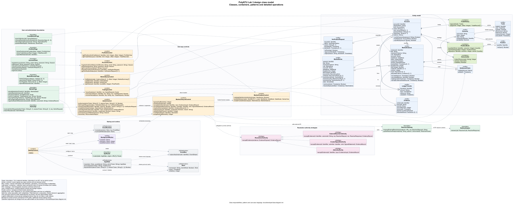

# Lab 3 draft design class model

Status: **intermediate draft - original checklist steps 1-4 only**, reviewed against source on **23 October 2026**.

This draft refines the existing conceptual/design diagram using the [use cases](use-cases.md) and active implementation. It covers manual 3.1.1, 3.1.2, and the startup/control bullets of 3.1.3. It retains the existing entity attributes and associations, adds startup wiring, and makes coordination ownership explicit. It does not establish the provenance of an untouched Lab 2 diagram or complete the later container, pattern, dialog-map, and detailed-signature work. See the [team handoff](../../lab3/steps-1-4-handoff.md).

The diagram has **31 classes: 10 entities, 8 boundaries, 8 controls, 4 infrastructure classes, and 1 active runtime abstraction**. The controls comprise the original **seven use-case controls plus StartupControl**; ApiRouter is the eighth boundary. These are design abstractions, not a claim that all 31 names exist as literal Rust/React classes. One self-contained PlantUML file defines the diagram.

## Diagram



[Open image](../diagrams/class-diagram.png) | [Editable PlantUML source](../diagrams/class-diagram.puml)

Green `<<boundary>>` classes handle interaction with people or external systems. Amber `<<control>>` classes coordinate use cases or startup. Blue `<<entity>>` classes represent domain information with identity. Grey `<<infrastructure>>` classes represent shared runtime/storage support; the purple `<<active>>` box abstracts a background task/module. Dashed arrows are dependencies; solid lines are entity associations. The diagram shows principal control-to-entity dependencies; the responsibility matrix below lists the other participating entities. Browser-to-control arrows summarize HTTP interactions; ApiRouter shows router construction in the startup view.

## Mapping the analysis concepts to the implementation

The ten existing entity definitions and their association multiplicities are preserved. Domain identity and responsibilities, rather than a one-box-per-source-file rule, guide the design mapping.

| Model element | Current representation |
|---|---|
| MarketInstance / MarketSeries | Rust `Instance` / `Series` in [market.rs](../../backend/src/market.rs), with SQL persistence. |
| Outcome | Rust `Outcome` supplies ID/label; its instance's inventory array supplies outstanding shares; probability is derived. |
| Account | The API/read-model `Account` struct in [store.rs](../../backend/src/store.rs) exposes a subset of the persisted account fields shown in the domain model. |
| VerificationRequest, Position, Trade, Evidence, SettlementClaim, LedgerTransfer | Persisted records accessed through SQL and returned through read models/JSON; no new Rust entity struct is implied for each box. |
| User boundaries | React function components and supporting browser functions, as listed below. |
| Seven use-case controls | Logical groups of handlers, `Store` methods, and helper functions. They allocate design responsibilities without extracting new controller structs. |
| Startup/runtime boxes | Existing structs or named functions/modules, as listed in the startup table. |

Stored password/token hashes in the domain model are not an instruction to expose them in the API Account response. `Store` remains a combined application/data-access facade in the current code; its supporting box does not mean all business logic has moved into a separate repository layer.

## Entity classes

| Entity | Responsibility and identity |
|---|---|
| Account | Participant identity and balance, or an issuance, treasury, or reserve balance. Identified by `accountId`. |
| VerificationRequest | Creator application, status, and decision reason. Identified by `requestId`. |
| MarketSeries | Immutable market definition, recurrence, fee choice, and resolution authority. Identified by `seriesId`. A one-time market is also a series. |
| MarketInstance | One concrete tradable occurrence with its own deadlines, inventory, reserve, and result. Identified by `instanceId`; this is `Instance` in the use cases/code. |
| Outcome | One published option and its outstanding inventory. Identified by its instance plus `index`; `outcomeId` is also unique within the instance. Probability is derived. |
| Position | An account's holdings in an outcome. Identified by the account/outcome pair; zero quantity may remain after a complete sale. |
| Trade | An executed buy or sell, including fee and all-in amount. Identified by `tradeId`. |
| Evidence | One evidence revision and its evaluated result, if available. Identified by `evidenceId`. |
| SettlementClaim | Final credit processed for an account in an instance, including a zero credit. Identified by the account/instance pair. |
| LedgerTransfer | One balanced movement of units between two accounts. Identified by `transferId`, with a unique business `reference`. |

### Relationships and constraints

- An account can submit many verification requests, with at most one pending. Every request has one requester.
- An account can create many series. A series has zero or one creator: no creator means platform-owned.
- A series can group many instances. A successfully published one-time series has exactly one; a recurring series can have none before spawning or after retention cleanup. An instance can have no series when created directly by the administrator.
- Each instance has exactly one reserve account. An account is reserve for at most one retained instance. Reserve accounts survive instance purging, so this association is not composition.
- `MarketInstance.creatorId` is an optional reference to an Account, separate from its reserve. It copies the series creator for spawned brackets and can be supplied for direct creation. It is represented as an attribute to avoid a second Account/MarketInstance line. Creators cannot trade their own instances.
- An instance owns 2 to 8 outcomes, each belonging to exactly one instance. This is composition. Positions and trades each connect one account to one outcome; that outcome identifies their instance.
- An instance can receive many evidence revisions. `selectedEvidence`, when present, must belong to that instance. Creator authority requires a valid signature under the fixed public key; resolver authority uses the fixed endpoint. Neither can be overridden by an administrator.
- A claim connects one account to one instance. The pair is unique, preventing duplicate payout credits. One winning share pays one unit; a void pays `1 / numberOfOutcomes` per share, aggregated per account and rounded down to the microcredit.
- Every ledger transfer has one source and one destination account, which must differ. Account balances reconcile to transfers; market reserves must cover remaining liabilities.
- Published definitions, schedules, outcomes, fee choices, and resolution authority are immutable. The instance state, suspension, inventory, evidence selection, and version change under the published rules.
- Fee-charging markets collect 25 basis points per trade. At settlement the creator gets half the fee pot rounded down to the microcredit, and the treasury receives the remainder. With no creator, the treasury receives all fees; fee-free markets have no fee pot.

### Attribute types and embedded values

The diagram groups related settings into value types. These values do not have independent identity and are not additional entity classes or proposed new database tables.

| Type | Meaning or fields |
|---|---|
| Identifier | Stable string identifier, including fixed system account identifiers. |
| Money / Quantity | Exact units / shares. Storage uses integer microcredits (1 unit = 1,000,000) and millishares (1 share = 1,000). |
| Timestamp | An instant, stored as Unix milliseconds. Display and recurring operating windows use Singapore time. |
| AccountKind / AccountRole | `user`, `treasury`, `reserve`, `issuance` / `member`, `creator`, `admin`. Role and registered credentials are absent for unregistered demo/provisioned accounts and system accounts. |
| VerificationStatus | `pending`, `approved`, `rejected`. |
| RecurrenceKind / SeriesState | `once`, `recurring` / `active`, `ended`. |
| InstanceState | `open`, `closed`, `resolving`, `resolved`, `voided`. Suspension is a separate Boolean. |
| AuthorityKind / DataMode / TradeSide | `admin`, `creator`, `resolver` / `simulated`, `manual` / `buy`, `sell`. |
| TransferKind | `issuance`, `grant`, `subsidy`, `buy`, `sell`, `resolution`, `release`, `fee`. |
| RecurrencePolicy | `intervalMs: Integer`, `activeStartMinute: Integer`, `activeEndMinute: Integer`, `activeDays: Set<Integer>`, `maxConcurrency: Integer`, `anchorAt: Timestamp`, `endAt: Timestamp [0..1]`. Required for recurring series; no end means perpetual. |
| MarketWindow | `closeAt`, `observationStartAt`, `observationEndAt`, `finalizeAfterAt`, `evidenceDeadlineAt`, all timestamps, satisfying `close <= observationStart < observationEnd <= finalizeAfter < evidenceDeadline`. |
| ResolverConfig | `endpoint: URL`, fixed at publication for resolver authority. |
| ResolutionKey | `publicKey: String`, the fixed ed25519 public key for creator authority. No private signing key is stored in these entities. |
| MarketRule | Tagged weather, bus, election, or count parameters, matching the current domain rules. |
| EvidencePayload | Either a normalized observation with its reference, a signed creator statement (outcome, nonce, signature, public key), or the recorded external resolver request/response and selected outcome. The observation form covers rainfall, bus arrivals, election result, or count data with relevant completion/finality flags. |
| Resolution | Either `winner(outcomeIndex)` or `void(reason)`; absent until determined. |

Registered accounts have email, password hash, and role together; user accounts have a token hash. Plaintext passwords and session tokens are not persisted as entity attributes. `Trader`, `Market Creator`, and `Platform Admin` are actor roles, not Account subclasses. Approval changes the role of an existing account.

## Boundary classes

| Boundary | Responsibility | Corresponding code or interface |
|---|---|---|
| AccountPanel | Account entry, creator-verification request/status, and local sign-out. Groups the related account interactions rather than introducing a new screen. | Account dialog, header account chip, and verification panel in [App.jsx](../../frontend/src/App.jsx). |
| MarketBrowsePage | Category filtering, live/history listings, and opening an instance. | [MarketBrowse.jsx](../../frontend/src/pages/MarketBrowse.jsx). The current UI has category filters, not a text-search field. |
| CreateMarketPage | Collects the definition, schedule, fee choice, and authority; submits publication. Prepares the creator's public key in the browser when required. | [CreateMarket.jsx](../../frontend/src/pages/CreateMarket.jsx). |
| MarketPage | Market facts, series brackets, charts, trade preview/confirmation/recovery, and signing a creator resolution. Groups its embedded UI components. | [MarketPage.jsx](../../frontend/src/pages/MarketPage.jsx), [TradePanel.jsx](../../frontend/src/components/TradePanel.jsx), and chart components. |
| PortfolioPage | Displays holdings, settlement credits, and private trade history. | [Portfolio.jsx](../../frontend/src/pages/Portfolio.jsx). |
| AdminApi | Receives authorized administrator requests and returns results. This is an API boundary, not an invented administrator screen. | Administrator routes in [api.rs](../../backend/src/api.rs). |
| ResolverGateway | Sends a resolution request to the configured external endpoint and parses its response. The external resolver itself is outside the system. | [resolver.rs](../../backend/src/resolver.rs). |
| ApiRouter | Builds the inbound HTTP API and its layers using shared application state; shown in the startup package. | Free `router` function in [api.rs](../../backend/src/api.rs), with static fallback/serving configured in [main.rs](../../backend/src/main.rs). |

`MarketPage.signAndSubmitResolution()` creates the signature in the browser. The control validates the submitted signature and authority; it does not receive the private signing key. `AccountPanel.signOutLocally()` clears the stored browser session and signing key; the current system does not expose a server logout/revocation operation.

## Control classes

These are proposed logical classes grouping existing responsibilities. In the current implementation, many methods live on `Store`, with thin HTTP handlers, a worker loop, and Rust helper modules. Creating this diagram does not refactor that code.

| Control | Coordination responsibility | Participating entities | Implementation mapping |
|---|---|---|---|
| AccountControl | Validate registration, grant the welcome gift atomically, authenticate/rotate sessions, return the current account, and submit/read creator requests. | Account, VerificationRequest, LedgerTransfer. | `register_account`, `login`, `account_by_id`, `create_verification_request`, `verification_request` in [store.rs](../../backend/src/store.rs), plus [auth.rs](../../backend/src/auth.rs) and the authenticated `me` handler in [api.rs](../../backend/src/api.rs). |
| MarketQueryControl | Load market/series snapshots, history, probabilities, and discovery listings. | MarketSeries, MarketInstance, Outcome, Trade. | `instances`, `instance_detail`, `instance_history`, `series_view` in [store.rs](../../backend/src/store.rs), with [amm.rs](../../backend/src/amm.rs). |
| MarketCreationControl | Validate the published definition/authority, require creator access for creator publication, publish series, and create funded instances for one-time, direct administrator, and recurring paths. | Account, MarketSeries, MarketInstance, Outcome, LedgerTransfer. | `create_series`, `create_instance` in [store.rs](../../backend/src/store.rs), validation in [market.rs](../../backend/src/market.rs), and route authentication/administrator authorization in [api.rs](../../backend/src/api.rs). The creator-role check occurs inside `create_series`. |
| TradingControl | Issue signed quotes; validate and execute trades atomically; apply fees, holdings, balance checks, self-trading prohibition, and idempotency. | Account, MarketInstance, Outcome, Position, Trade, LedgerTransfer. | `quote` and `execute` in [execution.rs](../../backend/src/execution.rs). `recoverReceipt()` models retrying the same trade request/key, not a new endpoint. |
| PortfolioControl | Assemble holdings, settlement credits, and private trade history for the authenticated account. | Account, MarketInstance, Outcome, Position, Trade, SettlementClaim. | `portfolio` and `trades` in [store.rs](../../backend/src/store.rs). |
| MarketLifecycleControl | Coordinate rolling spawn, closure, administrator/signed/automatic evidence, suspension changes, settlement, fee split, deadline voiding, and expired-bracket cleanup. | All ten entity classes except VerificationRequest. | `tick`/`process_instance` in [worker.rs](../../backend/src/worker.rs), `spawn_due_brackets`/`purge_expired_brackets` in [store.rs](../../backend/src/store.rs), evidence/suspension/settlement in [resolution.rs](../../backend/src/resolution.rs), and [fee.rs](../../backend/src/fee.rs). |
| AdminControl | Gate privileged entry points; approve/reject creator requests, provision accounts with grants, run reconciliation, and coordinate direct creation, administrator evidence, and suspension requests with the relevant logical control. | Account, VerificationRequest, MarketInstance, Outcome, Position, SettlementClaim, LedgerTransfer; creation/evidence paths use the entities owned by their collaborating controls. | `require_admin` and admin handlers in [api.rs](../../backend/src/api.rs), decisions/provisioning/reconciliation in [store.rs](../../backend/src/store.rs), and lifecycle methods in [resolution.rs](../../backend/src/resolution.rs). |

The lifecycle control is invoked by BackgroundWorker for background activity, MarketPage for a creator's signed submission, and AdminControl for privileged lifecycle requests. It depends on ResolverGateway for outbound calls. `setSuspension()` belongs to lifecycle mutation; AdminControl's `requestSuspension()` represents the privileged entry point. `acceptAdminEvidence()` remains subject to the fixed resolution authority.

### Collaboration and design rationale

| Collaboration or boundary | Allocation and rationale |
|---|---|
| AdminControl -> MarketCreationControl | The administrator gate owns authorization for direct creation; shared definition validation and funded-instance creation have one logical owner. The existing handler calls `Store::create_instance` directly. |
| MarketLifecycleControl -> MarketCreationControl | Scheduling selects due brackets; funded creation reuses `Store::create_instance`. `spawn_series_brackets` already makes this call. Renaming `fundOneTimeInstance()` to `createFundedInstance()` reflects all three callers. |
| AdminControl -> MarketLifecycleControl | Privileged evidence/suspension requests use the same lifecycle invariants as worker/creator paths. The current handlers call methods on the same Store; the arrow is logical collaboration, not a new controller call. |
| AccountControl / AdminControl | Members submit/read their verification requests; administrator decisions are a separate privileged responsibility. |
| MarketQueryControl / PortfolioControl | Public discovery and history stay separate from account-scoped holdings, credits, and trades. Category filtering is browser behaviour. |
| TradingControl / MarketLifecycleControl | Trading owns atomic trade effects and quote validation; lifecycle owns post-close resolution, claims, fee distribution, and cleanup. PortfolioControl only reads the results. |
| Controls / helpers | `amm.rs`, `fee.rs`, and cryptographic functions perform reusable calculations/verification; they do not become additional use-case controls. Provider calls stay behind ResolverGateway. |

The seven groups have high cohesion around their use cases. MarketLifecycleControl is the broadest, but its scheduling, evidence/resolution, and settlement/cleanup responsibilities all coordinate one market lifecycle; this draft retains one logical facade. Loose coupling is supported by the provider contract and pure pricing/fee helpers. Encapsulation is expressed by giving each mutation a clear owner and enforcing invariants inside its service/transaction path. The current Store/API SQL mix limits physical separation, so these are responsibility decisions rather than a completed layer refactor. Existing operation visibility is not being comprehensively redesigned in this pass.

TradingControl's `recoverReceipt()` replays the exact saved request and idempotency key through `execute`; there is no separate recovery endpoint. Demo clock advancement and the administrator's manual worker tick are existing operational paths in `api.rs`: after the administrator gate they invoke `advance_demo_clock` and/or `worker::tick`, reusing lifecycle processing. They do not introduce additional user use cases in this model.

Registration and its welcome gift share one transaction. By contrast, `create_series` commits the series before calling funded instance creation for a one-time schedule; it attempts series cleanup if that creation fails. The model does not claim that both publication stages form one database transaction.

## Startup and runtime support

| Class | Source mapping and responsibility |
|---|---|
| StartupControl `<<control>>` | Free `main` function in [main.rs](../../backend/src/main.rs); process initialization and normal shutdown. This is the eighth control, separate from the seven use-case controls. |
| Store `<<infrastructure>>` | Existing struct in [store.rs](../../backend/src/store.rs). `connect` creates the pool, runs migrations, invokes private `initialize`, and sets the cached clock offset. Existing business methods remain on this type. |
| AppState `<<infrastructure>>` | Existing struct and `new` in [api.rs](../../backend/src/api.rs); shared Store, secrets, and event bus. |
| ApiRouter `<<boundary>>` | Abstraction over free `router` in [api.rs](../../backend/src/api.rs), not a new Rust class. |
| BackgroundWorker `<<active>>` | Abstraction over `worker::run` and `worker::seed_demo` in [worker.rs](../../backend/src/worker.rs). The timer invokes `tick`, whose coordination responsibilities are represented by MarketLifecycleControl. |
| EventBus `<<infrastructure>>` | Existing struct in [events.rs](../../backend/src/events.rs); shared per-instance broadcast channels and subscriber registration. It is runtime plumbing, not a domain collection class for the later container exercise. |
| EventRuntime `<<infrastructure>>` | Abstraction over `events::run_listener` and `events::run_clock_refresher`; PostgreSQL notifications/cache updates/SSE fan-out and demo clock convergence. |

Startup follows the source order: tracing; configuration reads/bind restriction; database connection/migrations/bootstrap; optional provider configuration; EventBus/AppState construction and secret checks; conditional demo seeding; CORS/static/API setup and listener bind; launch all three background tasks; then serve HTTP. The clock-refresher task returns immediately outside demo mode. Following a normal graceful HTTP return, main aborts all three task handles. Errors propagate as Result values; the diagram does not imply comprehensive error-path cleanup or that all validation precedes database initialization.

Startup dependencies mean creates/configures/launches; they are not persistent domain associations. The source does not instantiate seven controller objects. Shared Store/EventBus dependencies indicate runtime use and do not prescribe unique ownership. See [architecture](../architecture.md#runtime-startup) for the detailed sequence; no sequence diagram is required.

### Example responsibilities across stereotypes

1. **Place a trade:** MarketPage captures the choice and confirmation; TradingControl validates the quote and executes the transaction; Trade, Position, Account, MarketInstance/Outcome, and LedgerTransfer reflect the result.
2. **Publish a market:** CreateMarketPage captures the definition; MarketCreationControl validates and publishes it; MarketSeries and a one-time MarketInstance are created, or the lifecycle control spawns recurring instances later.
3. **Resolve automatically:** MarketLifecycleControl asks ResolverGateway for evidence, validates the result against the published outcomes, then coordinates Evidence, SettlementClaim, Account, and LedgerTransfer changes. Pending or invalid answers retry until the deadline; unresolved instances then void.
4. **Approve a creator:** AdminApi receives an authorized decision; AdminControl updates VerificationRequest and Account; the account panel displays the resulting status on refresh.

## Use-case coverage

| Use cases | Boundary and control path |
|---|---|
| UC-1, UC-2, UC-3 | AccountPanel -> AccountControl. |
| UC-4 | PortfolioPage -> PortfolioControl; saved pending-trade recovery opens MarketPage -> TradingControl. |
| UC-5 | MarketBrowsePage -> MarketQueryControl. |
| UC-6 | AccountPanel -> AccountControl. |
| UC-7 | AdminApi -> AdminControl. |
| UC-8, UC-9, UC-10, UC-11 | CreateMarketPage -> MarketCreationControl. |
| UC-12 | BackgroundWorker -> MarketLifecycleControl -> MarketCreationControl for funded bracket creation. |
| UC-13 | MarketLifecycleControl -> ResolverGateway. |
| UC-14 | MarketPage -> MarketLifecycleControl, carrying the browser-signed statement. |
| UC-15, UC-16, UC-17 | BackgroundWorker -> MarketLifecycleControl. |
| UC-18 | MarketPage -> MarketQueryControl for probabilities, and TradingControl for a personal quote. |
| UC-19, UC-21 | MarketPage -> MarketQueryControl. |
| UC-20 | MarketPage -> TradingControl. |
| UC-22 | AdminApi -> AdminControl -> MarketLifecycleControl. |
| UC-23, UC-24 | AdminApi -> AdminControl. |
| UC-25 | AccountPanel clears local state; no server logout control is implied. |

The administrator's direct creation/evidence endpoints and the retention purge are existing implementation paths outside the numbered use-case register; their diagram coverage does not silently add new numbered requirements. Existing test examples are listed in the [handoff](../../lab3/steps-1-4-handoff.md#traceability-and-existing-test-pointers). They are navigation evidence, not a claim that tests were rerun or that full test traceability is complete.

## Scope and implementation details

Outcome is stored in the instance's outcome JSON and corresponding inventory array, not a standalone table. ResolverConfig and ResolutionKey are embedded series values. LedgerTransfer is the stored movement; LedgerEntry is a derived two-sided view. Portfolio, price history, and DayProbability are computed views, and Quote is a temporary signed value, so none needs its own entity box in this initial model.

Startup/shared runtime support is now included. Operational records such as idempotency, audit, SSE outbox, and cache entries remain outside the entity boxes. Receipt recovery uses idempotency records, while creator decisions and suspensions append audit records. Existing retention is preserved: eligible recurring instances and their associated trading/settlement records are purged, while ledger transfers and reserve accounts survive.

Operation names communicate responsibilities only. Container classes, pattern assessment, dialog-map changes, detailed signatures/entity operations, persistence/access-control design, AI exercises, and implementation audits remain for later owners. Existing entity attributes are retained rather than newly completing those tasks. This draft does not propose an administrator screen, text search, server logout, or application refactor. Use the team's completed later design, rather than this intermediate snapshot, for Lab 3.3.

## Re-rendering

Edit `docs/diagrams/class-diagram.puml`, then regenerate its PNG from the repository root:

```powershell
.\scripts\render-diagrams.ps1 -Diagram 'docs\diagrams\class-diagram.puml'
```

All class definitions are in that source file. Update this explanation when responsibilities or relationships change. The submission source/image in `lab3/` are snapshots of the canonical files; after a successful render, refresh them together:

```powershell
Copy-Item -LiteralPath 'docs\diagrams\class-diagram.puml' -Destination 'lab3\class-diagram.puml'
Copy-Item -LiteralPath 'docs\diagrams\class-diagram.png' -Destination 'lab3\class-diagram.png'
```
